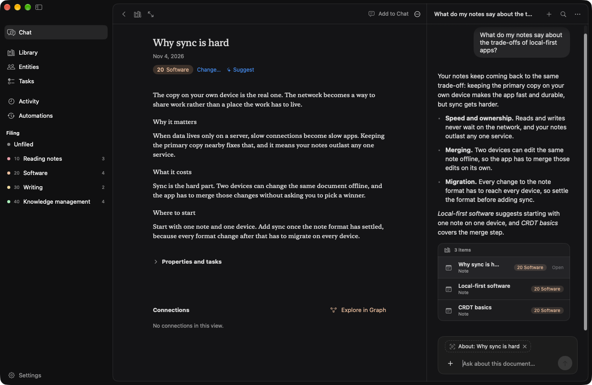

<p align="center">
  
</p>

<h1 align="center">Gleanary</h1>

<p align="center">
  A personal knowledge library you can talk to, for macOS
</p>

<p align="center">
  <a href="https://gleanary.app">Website</a> · <a href="https://gleanary.app/docs">Docs</a>
</p>

<p align="center">
  <a href="https://github.com/nightmodelabs/gleanary/releases/latest"></a>
  <a href="#requirements"></a>
  <a href="#build-from-source"></a>
  <a href="LICENSE"></a>
</p>

<p align="center">
  <picture>
    <source media="(prefers-color-scheme: dark)" srcset="docs/readme/screenshot-dark.png">
    <source media="(prefers-color-scheme: light)" srcset="docs/readme/screenshot-light.png">
    
  </picture>
</p>

🌿 Gleanary is an agentic, local-first personal knowledge management 
system with a conversational interface. Drop a link in chat, and let
Gleanary do the rest: retrieval, metadata normalization, research,
synthesis, and curation.

## Features

- 💬 **Chat**. Perform day-to-day knowledge work conversationally.
  Everything you wished you could automate with other knowledge
  management systems, that would otherwise require third-party plugins
  or complex workflows.
- 🗃️ **Organization**. Uses [Johnny.Decimal][1] to categorize notes and
  sources. Comes with batteries: a set of suggested starting categories
  for software engineers, writers, product managers, designers,
  researchers, and others. Chat with Gleanary to extend or replace with
  your own structure.
  - Sources are automatically filed across one or more categories that
    best fit extracted content via inference.
  - Visualize your library as a grid, list, or knowledge graph.
- 🏛️ **Entity extraction**. People, organizations, tools, etc. are
  inferred, normalized, enriched, and stored separately.
- ⚙️ **Automations**. The housekeeping and grunt work that agents excel
  at. Check for dead links, surface and automatically cross-link notes,
  retry failed captures, automatic summarization, and more, on a
  schedule or ad-hoc. *Coming soon: custom user-defined automations.* 

## Install

### Download

1. Download the `.dmg` file from the [latest release][9].
2. Open it and drag Gleanary to Applications.

### Requirements

- **Operating system:** macOS 26 or later.
- **Mac:** Apple silicon (M1 or later). The download doesn't run on
  Intel Macs.
- **Basic library use:** You can browse, search, and edit your library
  without Apple Intelligence or an AI provider account.
- **On-device AI:** Turn on Apple Intelligence in System Settings and
  wait for its model to finish downloading. No ChatGPT account or API
  key is needed.
- **Online AI:** Instead of Apple Intelligence, you can use your ChatGPT
  subscription or your own API key for OpenAI, Claude, Gemini, or
  OpenRouter. Gleanary uses [Sign in with ChatGPT (SIWC)](https://developers.openai.com/siwc/token-sharing-open-source)
  to connect your eligible ChatGPT subscription. ChatGPT use counts
  toward your subscription’s limits; no OpenAI API key is needed.
  API use is separate and may incur charges from the provider.

Chat, summaries, automatic filing, and entity extraction need an AI
provider. Choose on-device or online AI in Settings.

## Privacy and AI

Your library stays on your Mac, in Gleanary’s Application Support
folder. On-device AI uses Apple Intelligence to process your content
on your Mac.

Online AI is optional. You can choose ChatGPT, OpenAI, Claude, Gemini,
or OpenRouter in Settings. Gleanary asks your permission before sharing
with a provider. Requests can include your messages, recent chat history,
document titles, and relevant source text. Gleanary does not upload your
whole library. Sign-in credentials and API keys stay in your Mac’s Keychain.

## Build from source

You need macOS 26 or later, Xcode 26 or later (with Swift 6.2 and the
macOS 26 SDK), and [mise][2].
Open Xcode once to finish its setup before building.

From your local Gleanary repository folder:

1. **Trust the configuration** so mise can run the repository’s tasks:

   ```sh
   mise trust
   ```

2. **Install the tools** listed in `mise.toml`:

   ```sh
   mise install
   ```

3. **Build and open** the app:

   ```sh
   mise run dev
   ```

The app bundle is at `.build/Gleanary.app`. Quit Gleanary before running
`mise run dev` again to load your changes.

For a build without opening the app, run `mise run app:build`.
For an optimized build that also opens the app, run `mise run dev:release`.
The build uses local ad hoc signing by default; you do not need an
Apple Developer account.

## Acknowledgements

Gleanary builds on these open-source projects. Thank you to their
maintainers and contributors.

- **[GRDB.swift][3]** for storing and querying library data in SQLite.
- **[Grape][4]** for the simulation behind the knowledge graph layout.
- **[SwiftSoup][5]** for reading and extracting content from web pages.
- **[Swift Markdown Engine][6]** for displaying Markdown and math.
- **[Swift YouTube Metadata][7]** for YouTube transcripts, channel details,
  and comments.
- **[YouTubeKit][8]** for additional YouTube support.

## License

Gleanary is available under the [MIT License](LICENSE).

[1]: https://johnnydecimal.com/
[2]: https://mise.jdx.dev/getting-started.html
[3]: https://github.com/groue/GRDB.swift
[4]: https://github.com/SwiftGraphs/Grape
[5]: https://github.com/scinfu/SwiftSoup
[6]: https://github.com/nodes-app/swift-markdown-engine
[7]: https://github.com/arraypress/swift-youtube-metadata
[8]: https://github.com/alexeichhorn/YouTubeKit
[9]: https://github.com/nightmodelabs/gleanary/releases/latest
